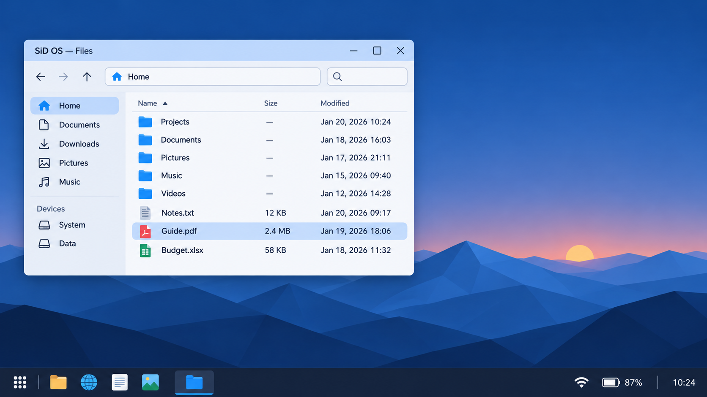
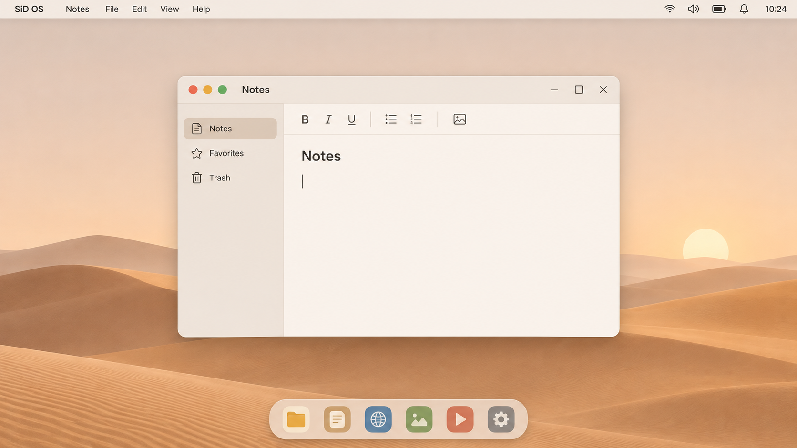
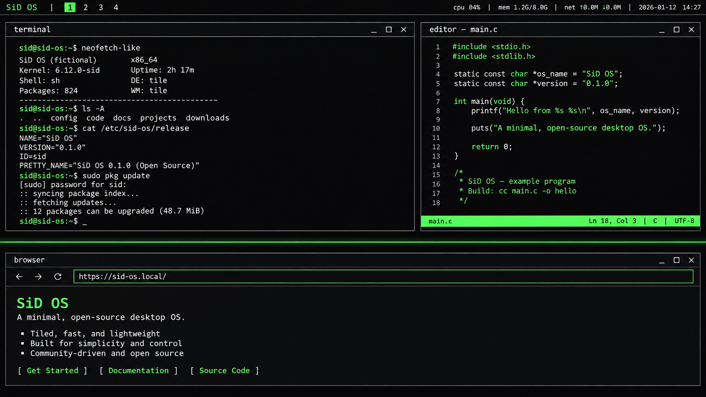
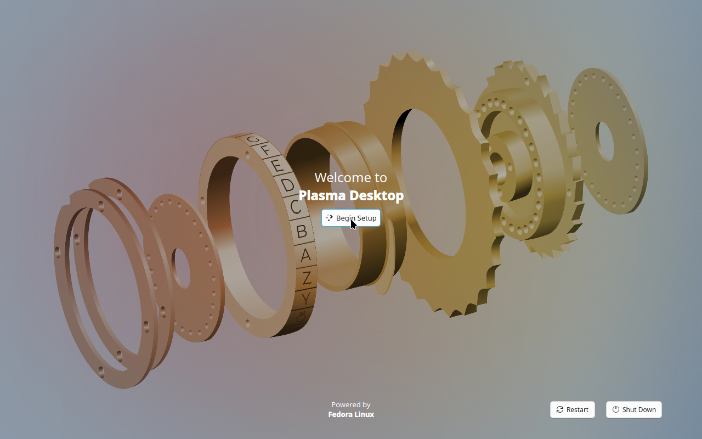

# SiD OS

[](https://github.com/sidhere24/sidos/actions/workflows/ci.yml)
[](https://github.com/sidhere24/sidos/discussions)
An open-source Linux distribution designed **laptop-first**: instant sleep/resume,
best-in-class battery life, atomic updates with automatic rollback, and a polished,
ad-free, telemetry-free experience — free, and friendly to contributors.

- Status: pre-alpha. CI builds + lints + publishes the bootc image; a real VM smoke
  test boots it to the Plasma first-run screen. Full session polish and the
  installable ISO are still in progress — see [`docs/validation-log.md`](docs/validation-log.md).
- License (tooling/docs): MIT/CC-BY-SA — see `LICENSE`, `docs/LICENSE.md`
- Docs: [`design-principles.md`](docs/design-principles.md) · [`experience-profiles.md`](docs/experience-profiles.md) · [`profile-classic.md`](docs/profile-classic.md) · [`profile-studio.md`](docs/profile-studio.md) · [`profile-flow.md`](docs/profile-flow.md) · [`assets.md`](docs/assets.md) · [`customization.md`](docs/customization.md) · [`download.md`](docs/download.md) · [`onboarding.md`](docs/onboarding.md) · [`faq.md`](docs/faq.md) · [`rfcs/0000-rfc-template.md`](docs/rfcs/0000-rfc-template.md) · [`naming-and-trademarks.md`](docs/naming-and-trademarks.md)
- Strategy: **default to the experience Windows users know, deliver the values Mac and
  Linux users love, exterminate everything they hate.** See below.

## A taste of SiD OS

Three One-button **Experience Profiles** are designed; the image now ships the
`laptop-experiences` switcher (wallpaper/icons/fonts/color) — full taskbar/dock/tiling
layouts remain concept art for now. These renders show the visual direction:

| Classic (default, Windows-refugee familiar) | Studio (calm, Mac-refugee) | Flow (tiling, Linux-native) |
|---|---|---|
|  |  |  |
| Familiar taskbar + Start-style App Grid, snap layouts & window groups | Dock + top menu bar, gesture-first, global menu | Tiling by default, mono fonts, keyboard-first |

Full specs: [`profile-classic.md`](docs/profile-classic.md) ·
[`profile-studio.md`](docs/profile-studio.md) ·
[`profile-flow.md`](docs/profile-flow.md)

### Proof it boots (real screenshot, 2026-11-21)



Actual VM boot of the published bootc image (WHPX/q35, `laptop-experiences` included).
The first login screen still says "Fedora Linux" — that's the upstream base, and
Personalization is the next pass: the SiD wallpapers/icons/fonts are shipped and
apply after account creation via the first-boot hook and `laptop-experiences`.
See [`docs/validation-log.md`](docs/validation-log.md).

## What it is

A Linux distribution — not a kernel and not a desktop widget collection. The goal is
the best possible laptop experience out of the box, with zero compromises on privacy
or user control.

## What it is not

- Not a general-purpose distro for servers/embedded (laptops only, for now)
- Not a reskin of another distro with a wallpaper swap
- Not a closed product — everything is open source and designed for contributors

## Repository map

```
brand/                logo (SVG) + original CC0 wallpapers + profile concept renders
docs/                 design principles, experience profiles, profile specs, naming policy
image/                bootc image build (Containerfile + package manifest)
packaging/            shipped profile configs + laptop-experiences CLI
scripts/              repo gates (trademark scan, etc.)
.github/              CI, issue/PR templates
```

## Contributing

See `CONTRIBUTING.md`. Docs-first: the design docs in `docs/` are the source of
truth. DCO sign-off, no CLA. AI tools welcome, understanding mandatory.

## Status & how to try

Pre-alpha, Phase 2. **There is no installable ISO yet** — the image builds, passes
`bootc container lint`, and publishes to ghcr.io on every push. What follows is the
honest state + the install paths that exist.

## Download & Install (early adopters)

Full guide: [`docs/download.md`](docs/download.md)

- **Option A** — `sudo bootc switch --apply ghcr.io/sidhere24/sidos:latest` from any
  Fedora Atomic system. Works today.
- **Option B** — ask in Discussions for the 5.6 GB qcow2 (over GitHub's 2 GB Release
  asset limit, so it isn't hosted here), or build your own with `podman build -f image/Containerfile .`
- **Option C** — installable ISO needs a Fedora host to build; see `docs/download.md`

## Community

GitHub Discussions: **https://github.com/sidhere24/sidos/discussions**
— ask questions, share ideas, report hardware quirks. Bugs → Issues; security →
`SECURITY.md`; conduct → Contributor Covenant.
