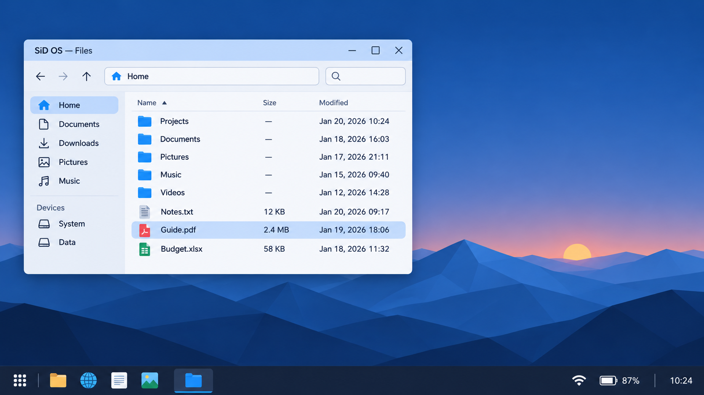
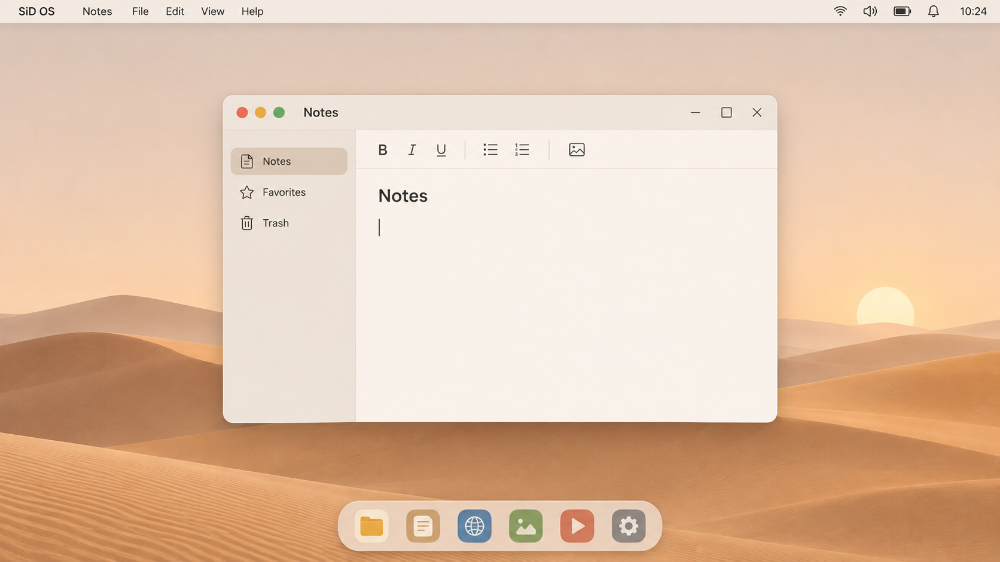
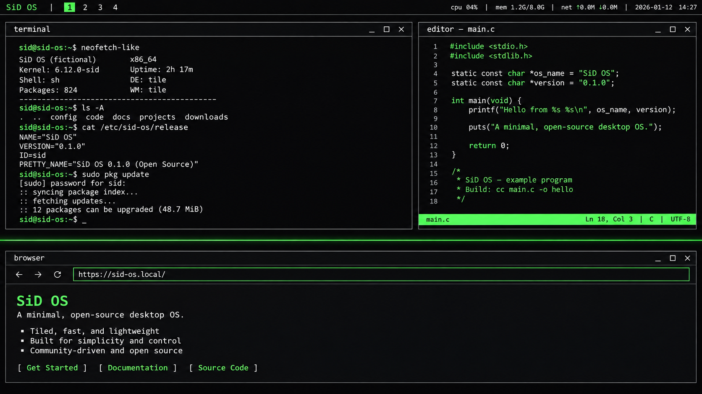

# SiD OS

[](https://github.com/sidhere24/sidos/actions/workflows/ci.yml)
[](https://github.com/sidhere24/sidos/discussions)
An open-source Linux distribution designed **laptop-first**: instant sleep/resume,
best-in-class battery life, atomic updates with automatic rollback, and a polished,
ad-free, telemetry-free experience — free, and friendly to contributors.

- Status: pre-alpha, Phase 2 skeleton (bootc image + docs complete)
- License (tooling/docs): MIT/CC-BY-SA — see `LICENSE`, `docs/LICENSE.md`
- Docs: [`design-principles.md`](docs/design-principles.md) · [`experience-profiles.md`](docs/experience-profiles.md) · [`profile-classic.md`](docs/profile-classic.md) · [`profile-studio.md`](docs/profile-studio.md) · [`profile-flow.md`](docs/profile-flow.md) · [`assets.md`](docs/assets.md) · [`customization.md`](docs/customization.md) · [`onboarding.md`](docs/onboarding.md) · [`faq.md`](docs/faq.md) · [`rfcs/0000-rfc-template.md`](docs/rfcs/0000-rfc-template.md) · [`naming-and-trademarks.md`](docs/naming-and-trademarks.md)
- Strategy: **default to the experience Windows users know, deliver the values Mac and
  Linux users love, exterminate everything they hate.** See below.

## A taste of SiD OS

Three one-button **Experience Profiles** on one desktop (Plasma 6). Switch anytime in
Settings → Experience or with `laptop-experiences switch <name>`. These are concept
renders pending the first VM screenshots — the visual direction, not the final pixels.

| Classic (default, Windows-refugee familiar) | Studio (calm, Mac-refugee) | Flow (tiling, Linux-native) |
|---|---|---|
|  |  |  |
| Familiar taskbar + Start-style App Grid, snap layouts & window groups | Dock + top menu bar, gesture-first, global menu | Tiling by default, mono fonts, keyboard-first |

Full specs: [`profile-classic.md`](docs/profile-classic.md) ·
[`profile-studio.md`](docs/profile-studio.md) ·
[`profile-flow.md`](docs/profile-flow.md)

## What it is

A Linux distribution — not a kernel and not a desktop widget collection. The goal is
the best possible laptop experience out of the box, with zero compromises on privacy
or user control.

## What it is not

- Not a general-purpose distro for servers/embedded (laptops only, for now)
- Not a reskin of another distro with a wallpaper swap
- Not a closed product — everything is open source and designed for contributors

## Repository map

```
brand/                logo (SVG) + original CC0 wallpapers + profile concept renders
docs/                 design principles, experience profiles, profile specs, naming policy
image/                bootc image skeleton + Phase 2 package manifest
scripts/              repo gates (trademark scan, etc.)
.github/              CI, issue/PR templates
```

## Contributing

See `CONTRIBUTING.md`. Docs-first: the design docs in `docs/` are the source of
truth. DCO sign-off, no CLA. AI tools welcome, understanding mandatory.

## Status & how to try

Pre-alpha, Phase 2. **There is no installable ISO yet** — the image builds, passes
`bootc container lint`, and publishes to ghcr.io on every push. What follows is the
honest state + the install paths that exist.

## Download & Install (early adopters)

### Option A — `bootc switch` from an existing Fedora Atomic system (works today, free)
On a machine running **Fedora Atomic Kinoite/Silverblue/KDE Plasma Desktop Atomic**:

```bash
sudo bootc switch --apply ghcr.io/sidhere24/sidos:latest
# reboot; if anything fails, boot the previous deployment from the GRUB menu — it just works (rollback is automatic)
```

This replaces the OS image with SiD OS atomically; your `/home` and data are kept.
Best path for developers and testers who can reinstall Fedora quickly.

### Option B — Test in a VM (no commitment)
Needs any x86_64 hypervisor (virt-manager/GNOME Boxes on Linux, QEMU on Windows,
Hyper-V, VirtualBox):

```powershell
winget install SoftwareFreedomConservancy.QEMU
qemu-img create -f qcow2 sidos-test.qcow2 32G
```
Once the ISO/qcow2 lands on Releases (Phase 2 completion), grab it there.

### Option C — Installable ISO (coming first)
ISO + USB flash instructions (balenaEtcher/Rufus) will be added to Releases when the
session and installer work is finished. Watch
[Releases](https://github.com/sidhere24/sidos/releases) or the Discussions forum.

## Community

GitHub Discussions: **https://github.com/sidhere24/sidos/discussions**
— ask questions, share ideas, report hardware quirks. Bugs → Issues; security →
`SECURITY.md`; conduct → Contributor Covenant.
